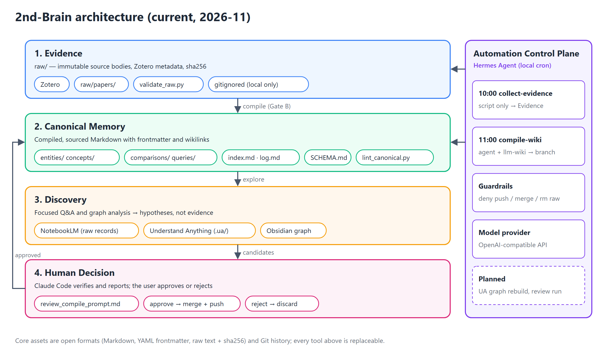
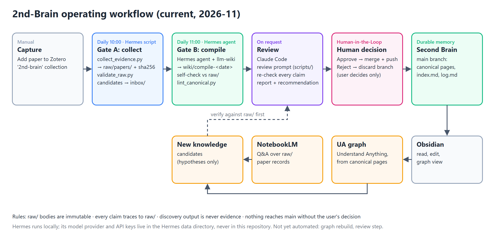
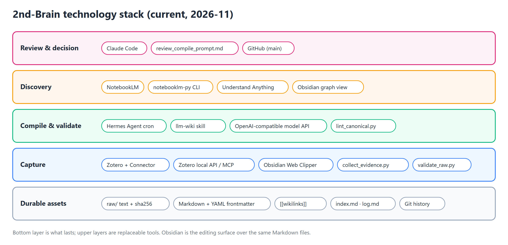

# 2nd Brain Template

**English** | [한국어](README.ko.md)

> A Markdown-based knowledge management template for collecting scattered thoughts and information, connecting them, and turning them into action.

## Project Overview

This project goes beyond simply storing notes. It is designed around a continuous **capture → organize → connect → act → review** workflow. Every note is stored as a plain Markdown file, so the system is not tied to a particular application and can be used with Obsidian, VS Code, GitHub, or any other Markdown-compatible tool.

### Architecture

The [complete architecture](docs/architecture/second-brain-pkm-architecture.md) consists of four layers: **Evidence → Canonical Memory → Discovery → Human Decision**. Original content and metadata are preserved as immutable evidence, while only reusable knowledge is compiled into canonical Markdown with traceable sources. Relationships discovered through NotebookLM and the knowledge graph remain hypotheses until human verification promotes them into durable memory.



### Operating Workflow

The [operating workflow](docs/architecture/second-brain-pkm-architecture.md#6-핵심-워크플로우) follows **Capture → Gate A: collect → Gate B: compile → Review → Human decision → Second Brain**. Each gate runs its validator (`validate_raw.py`, `lint_canonical.py`) and a check of every claim against `raw/`; nothing reaches `main` without the user's approval. NotebookLM and the knowledge graph feed new candidates back into the same review as hypotheses.



### Technology Stack

The core assets in the [technology stack](docs/architecture/second-brain-pkm-architecture.md#5-기술-스택) are not particular products, but **open-format source material, canonical Markdown, provenance metadata, and Git history**. Zotero, Hermes Agent with `llm-wiki`, Obsidian, NotebookLM, Understand Anything, and Claude Code are replaceable tools for capture, compilation, editing, discovery, and review. Integrity checks and human approval gates connect the stack.



### Current Implementation

The diagrams above show the current system; the [architecture document](docs/architecture/second-brain-pkm-architecture.md) also covers planned parts. This is what runs today (status as of 2026-11-01: 25 raw paper records, 23 canonical pages).

| Time / trigger | Step | What runs | Output |
| --- | --- | --- | --- |
| Manual | Capture | The user adds a paper to the Zotero `2nd-brain` collection | Zotero item |
| Daily 10:00 (Hermes cron, script only) | Gate A: collect | `scripts/collect_evidence.py` captures new items into `raw/papers/`, runs `scripts/validate_raw.py`, and writes paper candidates to `inbox/` | Raw records, `ingest`/`lint` log entries |
| Daily 11:00 (Hermes cron, agent with `llm-wiki`) | Gate B: compile | The agent follows `scripts/compile_wiki_prompt.md`: compiles pending records on a `wiki/compile-<date>` branch, self-checks every number and comparison against the raw text, and runs `scripts/lint_canonical.py` | Branch awaiting review |
| On request ("검토해줘") | Review | A coding agent (Claude Code) follows `scripts/review_compile_prompt.md`: re-checks every claim against `raw/`, fixes errors, and writes a plain-language report with an approve/reject recommendation | Report, `repair` log entry |
| Human decision | Human-in-the-Loop | The user approves or rejects; only then is the branch merged and pushed, or discarded | Updated `main` |
| Manual | Discovery | NotebookLM notebook over the raw records; Understand Anything graph built from canonical pages into `.ua/` | Hypotheses only, verified against `raw/` before any wiki change |

Hermes runs locally with an OpenAI-compatible model provider configured in Hermes itself; API keys live only in the Hermes data directory, never in this repository. Not yet automated: graph regeneration and the review step.

## Key 2nd-Brain Features

The system connects safe source preservation and verified knowledge reuse in one continuous cycle.

| Feature | Description |
| --- | --- |
| **Source and provenance preservation** | Capture papers and web material with Zotero and Web Clipper, then preserve the source, metadata, and SHA-256 digest under `raw/` so every claim can be traced back to evidence. |
| **Verified knowledge compilation** | LLM Wiki structures source material into concept, comparison, and query documents while accumulating provenance, confidence, contradictions, and relationships. |
| **Connected exploration and editing** | Follow the second-brain research workflow to read and edit durable knowledge in Obsidian using Markdown, wikilinks, and backlinks. |
| **Source-grounded focused research** | Use the NotebookLM query compounding workflow to question a constrained source set and file only results whose reuse value has been verified. |
| **Knowledge graph analysis** | Use the UA knowledge graph workflow to find clusters, bridges, isolated documents, and possible knowledge gaps, then verify graph results against the source material. |
| **Human verification and feedback** | The research feedback loop classifies discoveries as accepted, contested, deferred, or rejected and feeds only approved knowledge back into the index and change history. |

## Prerequisites

If you only need a general Markdown editor, installing Obsidian is enough to get started. To use the full workflow—from web and paper capture to AI-assisted knowledge organization and graph exploration—prepare the tools below in order.

### Apps and Data Capture Tools

| Category | Tool | Purpose and installation |
| --- | --- | --- |
| Required | [Obsidian](https://obsidian.md/download) | Open this repository as a local vault to browse and edit Markdown notes. |
| Paper capture | [Zotero and Zotero Connector](https://www.zotero.org/download/) | Use the Zotero desktop application to manage papers, PDFs, and bibliographic data. Install the Chrome Connector from the same download page to save paper metadata from the web into Zotero. |
| Web capture | [Obsidian Web Clipper](https://obsidian.md/clipper) | Convert web pages and their metadata into Markdown from Chrome and save them to the Obsidian vault. |

### AI Automation Tools

The following tools allow an agent to retrieve captured material, organize it into knowledge notes, and visualize relationships. They are MCP servers, CLIs, or agent skills rather than Obsidian plugins.

> [!IMPORTANT] Install for your agent environment
> MCP configuration files, project and local skill paths, plugin support, and restart procedures differ between agents. Read the official installation documentation linked below and choose the method supported by your current agent or MCP client. Do not copy commands or configuration intended for a different agent without adapting them.

| Tool | Role | Installation guidance |
| --- | --- | --- |
| [Zotero MCP](https://github.com/54yyyu/zotero-mcp) | Gives an agent access to Zotero bibliographic metadata, attachments, notes, and full text. | Follow the official repository instructions to install and register the server with your MCP client. Verify the Zotero local API configuration as described in the official guide. |
| [`llm-wiki`](https://github.com/ains-lab/harness/tree/main/skills/llm-wiki) | Compiles captured source material into an interlinked Markdown knowledge base with traceable provenance and validates the result. | Read the linked skill documentation together with your agent's skill installation guide, then install it in a supported local or project skill location. |
| [notebooklm-py](https://github.com/teng-lin/notebooklm-py) | Manages NotebookLM notebooks and sources through a CLI and automates grounded questions and artifact generation. | Follow the official installation and authentication documentation for your Python and browser environment. If an agent will invoke it, also configure CLI access according to that agent's integration model. |
| [Understand Anything](https://github.com/Egonex-AI/Understand-Anything) | Analyzes relationships in code and knowledge bases and creates an interactive knowledge graph. | Select the installation and integration method for your agent or development environment from the official repository, then use its verification procedure to confirm that the skill or plugin is recognized. |

> [!NOTE]
> `notebooklm-py` uses an unofficial Google API, so service changes may affect its behavior. Never commit authentication information such as Google login sessions or Zotero API keys to this repository.

### Recommended Installation Order

1. Install Obsidian and open this repository directory as a vault.
2. Install the Zotero desktop application, Zotero Connector, and Obsidian Web Clipper.
3. Review the supported environments and prerequisites at each official link above.
4. Follow the Zotero MCP documentation to connect Zotero to your current MCP client.
5. Install `llm-wiki` and Understand Anything according to both their official documentation and your agent's skill or plugin installation rules.
6. If needed, install `notebooklm-py` and complete authentication using its official documentation.

After installation, use your environment's MCP server list, skill or plugin list, or CLI verification procedure to confirm that each tool is recognized. Follow the official documentation for exact verification commands and restart requirements.

## Recommended Directory Structure

The repository root is both the wiki root and the Obsidian vault. All paths are resolved relative to this root without a separate database, and [SCHEMA.md](SCHEMA.md) defines the validity contract for directories and data.

```text
.
├── inbox/                    # Temporary input awaiting classification and formal capture
├── raw/                      # Immutable source evidence
│   ├── articles/             # Article and web-clipping source text
│   ├── notebooklm/           # Source records imported from NotebookLM
│   ├── papers/               # Captured paper Markdown records (Zotero metadata + full text)
│   │   └── files/            # Paper attachments, created only when needed
│   ├── transcripts/          # Audio, video, and meeting transcripts
│   ├── web/                  # Web captures with importer-preserved paths
│   ├── youtube/              # YouTube metadata and transcripts
│   └── assets/               # Images and attachments referenced by source records
├── entities/                 # Canonical knowledge about people, organizations, and tools
├── concepts/                 # Canonical knowledge about concepts, principles, and methods
├── comparisons/              # Canonical side-by-side analysis of tools and methods
├── queries/                  # Source-grounded questions and synthesized answers
├── docs/                     # Architecture, workflow, and technology-stack artifacts
│   ├── architecture/
│   ├── tech-stack/
│   └── workflow/
├── templates/                # Validated note templates, created only when needed
├── _archive/                 # Fully superseded canonical knowledge, created only when needed
├── .obsidian/                # Shareable Obsidian configuration
├── SCHEMA.md                 # Authoritative directory, metadata, and integrity contract
├── index.md                  # Complete catalog of active canonical knowledge
└── log.md                    # Append-only wiki operation history
```

`raw/papers/files/`, `templates/`, and `_archive/` are created only when their workflows require them; `raw/papers/` itself is a core source directory like the other `raw/` subfolders. Knowledge graph caches such as `.ua/` and other generated outputs are reproducible derived data, so they are not treated as canonical knowledge or source evidence.

### What the Structure Means

| Category | Location | Meaning and management |
| --- | --- | --- |
| Temporary intake | `inbox/` | Holds input whose source format and classification are not yet settled. These files are neither evidence nor canonical knowledge and should eventually be captured under `raw/` or removed. |
| Layer 1: source evidence | `raw/` | Preserves captured bodies and provenance metadata. After initial capture, the body is generally immutable; corrections and interpretation belong in canonical knowledge. |
| Layer 2: canonical knowledge | `entities/`, `concepts/`, `comparisons/`, `queries/` | Synthesizes reusable knowledge from source evidence. The directory name must match the frontmatter `type`. |
| Layer 3: operational metadata | `SCHEMA.md`, `index.md`, `log.md` | Defines the schema contract, active knowledge navigation, and change history. Apply their rules as one transaction whenever canonical knowledge changes. |
| Supporting and derived artifacts | `docs/`, `.obsidian/`, `.ua/` | Supports documentation, editing, and graph exploration but does not serve as evidence. In particular, graph-proposed relationships remain hypotheses until verified against source material. |

## Quick Start

### 1. Clone the Repository

```bash
git clone git@github.com:ains-lab/2nd-brain-template.git
cd 2nd-brain-template
```

### 2. Open It in Your Preferred Markdown Editor

- **Obsidian**: Select `Open folder as vault` and choose the repository directory.
- **VS Code**: Run `code .` from the repository.
- **Other editors**: Any tool that can edit Markdown files and directories will work.

The base directories are included when you clone the repository, so you do not need to create a separate numbered classification hierarchy.

### 3. Review the Operating Contract

Before adding knowledge, read [SCHEMA.md](SCHEMA.md), check [index.md](index.md) for subjects already covered, and review the latest entries in [log.md](log.md). If the subject already exists, strengthen the existing page with new evidence instead of creating a similar duplicate.

## Basic Workflow

1. **Temporary intake**: Put unclassified notes and links in `inbox/`.
2. **Source capture**: Store provenance metadata and the captured body under the appropriate `raw/` subdirectory. For supported records, fix integrity with a SHA-256 digest computed from the body bytes.
3. **Validation**: Verify the real source path, required metadata, hash, and file format. Do not arbitrarily rename importer-preserved filenames or relative paths. Run `python scripts/validate_raw.py` after every capture.
4. **Knowledge compilation**: Create or update canonical knowledge under `entities/`, `concepts/`, `comparisons/`, or `queries/`, depending on the subject.
5. **Record provenance and connections**: Add real `raw/*.md` paths to `sources`, use `^[raw/...md]` markers where claims need precise attribution, and connect related canonical knowledge with `[[wikilinks]]`.
6. **Synchronize metadata**: Update `index.md` and append one operation entry to `log.md` as part of the same canonical change.
7. **Explore and verify**: Treat NotebookLM and knowledge graph results as discovery candidates. Feed back only content that a person has verified against the sources.
8. **Archive**: Move only fully superseded pages to `_archive/`, repair active links and `index.md`, and record the operation in `log.md`.

## Data Management Principles

> [!IMPORTANT]
> `README.md` is a usage guide; [SCHEMA.md](SCHEMA.md) is the authoritative data contract. Follow `SCHEMA.md` whenever the two appear to differ.

- **Source bodies are immutable.** Do not modify the `raw/` body after initial capture. The only exceptions are the Zotero metadata repair and NotebookLM frontmatter mapping operations allowed by the schema, each of which has byte-preservation requirements.
- **Source paths must exist.** Canonical `sources` may contain only real Markdown files under registered `raw/` source directories. A PDF or image attachment alone is not a valid source.
- **Canonical knowledge is selective.** Promote a subject only when it is central to one source or repeated across at least two sources. Add new evidence to an existing subject instead of creating a duplicate page.
- **Canonical knowledge is connected.** When active canonical pages exist, every page must link to at least two distinct active pages other than itself using `[[wikilinks]]`.
- **Changes are recorded together.** Creating, updating, filing a query, archiving, or deleting canonical knowledge is complete only after updating `index.md` and appending to `log.md`. Never rewrite or remove earlier log entries.
- **Derived data stays separate.** Material under `docs/` and graph data under `.ua/` support analysis but are not source evidence. Never cite them as `raw/` evidence or promote them automatically into canonical knowledge.

## Synchronization and Backup

Use Git to manage the history of Markdown files.

```bash
git add .
git commit -m "docs: update second brain notes"
git push
```

Never store sensitive personal information, passwords, or API keys in the repository. When using multiple devices, consider an official editor synchronization service or another trusted backup method in addition to Git.

## Extending the Schema

Before adding a new source type, tag, or automation, register its role and integrity rules in [SCHEMA.md](SCHEMA.md). When adding a source directory, define the file formats that qualify as canonical `sources` and the path-preservation policy. Register new tags in the taxonomy before using them.

Templates, dashboards, calendars, and automation should preserve open Markdown and provenance metadata without overwriting canonical knowledge. Long-term preservation of `raw/` evidence, canonical Markdown, `index.md`, `log.md`, and Git history takes priority over replaceable tools.

## Contributing

Share improvement ideas and new templates through an Issue or Pull Request. Changes should remain understandable in a general Markdown environment instead of depending exclusively on one tool.
